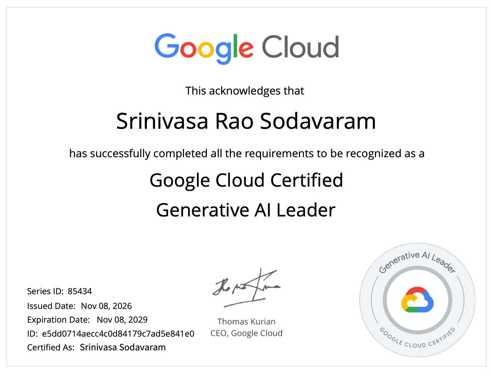

# Google Cloud Generative AI Leader — Exam Study Guide

This repo has **detailed notes** for each exam section and subsection, based on the official [Generative AI Leader exam guide](https://services.google.com/fh/files/misc/generative_ai_leader_exam_guide_english.pdf) and [study guide](https://services.google.com/fh/files/misc/generative_ai_leader_study_guide_english.pdf).

> A **Generative AI Leader** understands how gen AI can transform a business, knows Google Cloud's gen AI offerings at a business level, and guides organizations toward innovative and **responsible** AI adoption. The exam is aimed at business-focused roles; it does **not** require hands-on technical experience.

## 🏅 My Certification

I passed the **Google Cloud Generative AI Leader** exam. [Verify on Credly](https://www.credly.com/badges/e5ffe0d3-d25d-4ce0-9d0b-0fcadcef790a/public_url)
---

## Exam at a Glance

- **Exam Name:** Google Cloud Certified — Generative AI Leader
- **Time:** 90 minutes
- **Format:** 50–60 multiple-choice questions
- **Languages:** English, Japanese, Spanish, Portuguese
- **Delivery:** Online proctored, or onsite proctored at a testing center
- **Fee:** USD $99 (plus tax where applicable)
- **Prerequisites:** None
- **Recommended experience:** None required; open to all roles, technical or not
- **Validity:** 3 years (renewal via designated courses / skill badges on Google Skills)

*Details checked against the [official certification page](https://cloud.google.com/learn/certification/generative-ai-leader) in November 2026. Always confirm there before booking.*

---

## Exam Domains & Objectives

| Section | Domain | Weight | Objectives |
|---------|--------|--------|------------|
| 1 | [Fundamentals of Gen AI](sections/section1_fundamentals.md) | ~30% | [1.1 Core Concepts & Use Cases](sections/section1_fundamentals.md#11-core-concepts-and-use-cases) [1.2 Data Types](sections/section1_fundamentals.md#12-data-types-in-gen-ai) [1.3 Landscape Layers](sections/section1_fundamentals.md#13-gen-ai-landscape-layers) [1.4 Google's Foundation Models](sections/section1_fundamentals.md#14-googles-foundation-models) |
| 2 | [Google Cloud's Gen AI Offerings](sections/section2_offerings.md) | ~35% | [2.1 Google Cloud's Strengths](sections/section2_offerings.md#21-google-clouds-strengths) [2.2 Prebuilt Offerings](sections/section2_offerings.md#22-prebuilt-offerings-for-ai-powered-work) [2.3 Customer Experience](sections/section2_offerings.md#23-customer-experience-offerings) [2.4 Developer Tools & RAG](sections/section2_offerings.md#24-developer-tools-agent-platform-rag-and-custom-agents) [2.5 Agent Tooling & APIs](sections/section2_offerings.md#25-agent-tooling-apis-and-which-studio-to-use) |
| 3 | [Techniques to Improve Model Output](sections/section3_model_output.md) | ~20% | [3.1 Overcoming Limitations](sections/section3_model_output.md#31-overcoming-model-limitations) [3.2 Prompt Engineering](sections/section3_model_output.md#32-prompt-engineering-techniques) [3.3 Grounding, RAG & Sampling](sections/section3_model_output.md#33-grounding-rag-and-sampling-settings) |
| 4 | [Business Strategies for Gen AI](sections/section4_business_strategy.md) | ~15% | [4.1 Implementation](sections/section4_business_strategy.md#41-implementing-a-gen-ai-solution) [4.2 Secure AI (SAIF)](sections/section4_business_strategy.md#42-secure-ai) [4.3 Responsible AI](sections/section4_business_strategy.md#43-responsible-ai) |

Each section ends with a short **Quick Check** quiz. Click to reveal the answers.

---

## Product Name Changes (2026)

At **Google Cloud Next '26 (April 2026)**, Google renamed **Vertex AI to Gemini Enterprise Agent Platform** and rebranded several related products. The current exam guide uses the **new** names, but many courses, blogs and practice tests still use the old ones.

| Old name | Current name |
|----------|--------------|
| Vertex AI | Gemini Enterprise Agent Platform ("Agent Platform") |
| Vertex AI Studio | Agent Studio |
| Vertex AI Search | Agent Search |
| Vertex AI Agent Builder | Part of Agent Platform |
| Vertex AI Agent Engine | Agent Runtime |
| Vertex AI RAG Engine | RAG Engine |
| Vertex AI Vector Search | Vector Search |
| Vertex AI Model Garden | Model Garden |
| Vertex AI Model Registry / Pipelines / Feature Store | Agent Platform Model Registry / Pipelines / Feature Store |
| Google Agentspace | Gemini Enterprise |
| Contact Center AI → Customer Engagement Suite | Gemini Enterprise for Customer Experience (CX) |
| NotebookLM | Gemini Notebook (as named in the study guide) |

---

## Study Plan (suggested 2–3 weeks)

1. Read the official exam guide and take the **sample questions** to find your baseline.
2. Work through the **Google Skills learning path** (link below).
3. Study one section of this repo per few days, focusing on **Section 2** (~35%).
4. Open the **[shared Gemini Notebook (NotebookLM) for this exam](https://notebook.google.com/notebook/2ed85808-bdef-4ca7-81ed-4efda1eadf12/preview)** and use it to ask questions, generate an audio overview and quiz yourself.
5. Retake the sample questions, review weak areas, then book the exam.

---

## Study with Gemini Notebook (NotebookLM)

📒 **[Open the shared study notebook](https://notebook.google.com/notebook/2ed85808-bdef-4ca7-81ed-4efda1eadf12/preview)**

Gemini Notebook answers only from the sources loaded into the notebook, with citations. Use it to:
- Ask questions about any exam objective ("Explain SAIF's six elements with an example").
- Generate an **audio overview** to listen to on the go.
- Ask it for practice questions on your weakest section.

---

## Official Resources

- [Certification page](https://cloud.google.com/learn/certification/generative-ai-leader)
- [Exam guide (PDF)](https://services.google.com/fh/files/misc/generative_ai_leader_exam_guide_english.pdf)
- [Study guide (PDF)](https://services.google.com/fh/files/misc/generative_ai_leader_study_guide_english.pdf)
- [Learning path — Google Skills](https://www.cloudskillsboost.google/paths/1951)
- [Partner learning path](https://partner.cloudskillsboost.google/paths/1952)
- [Sample questions](https://forms.gle/soztS7Q74AXBncATA)
- [Register for the exam](https://cp.certmetrics.com/google/en/login)
- [Certification FAQs](https://support.google.com/cloud-certification/#topic=9433215)
- [Online testing requirements (Pearson VUE)](https://www.pearsonvue.com/us/en/onvue/requirements.html)
- [Google AI Principles](https://ai.google/principles/)
- [Secure AI Framework (SAIF)](https://safety.google/cybersecurity-advancements/saif/)
- [Google Cloud community](https://discuss.google.dev/c/google-cloud/14)
- [Exam outline summary used for this repo](sources/official-guide.md)

---

## Contributing

Spotted an error, an outdated product name or a missing topic? Open an issue or a pull request. Product names in this space change often.

## Disclaimer

- This is an **unofficial**, community study guide. It is not affiliated with, sponsored by or endorsed by Google.
- All notes, tables, examples and quiz questions are **original summaries written for this repo**. No official exam questions, course content or document text are reproduced here. For authoritative wording, use the official links above.
- Google, Google Cloud, Gemini, Gemma, Imagen, Veo, Google Workspace, NotebookLM and related product names are **trademarks of Google LLC**. They are used here only to identify the products being studied.
